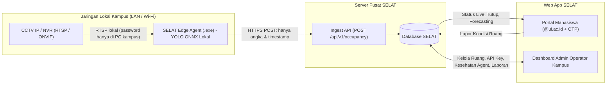
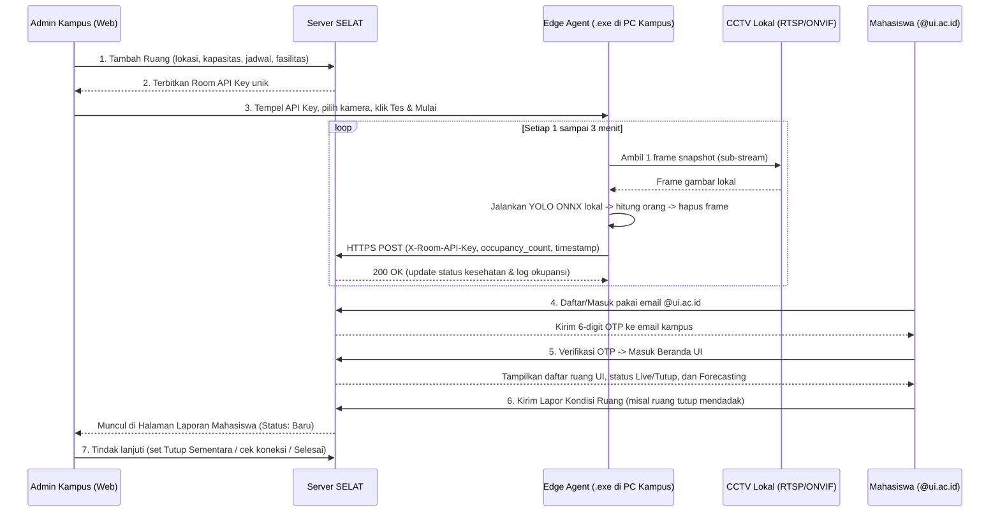
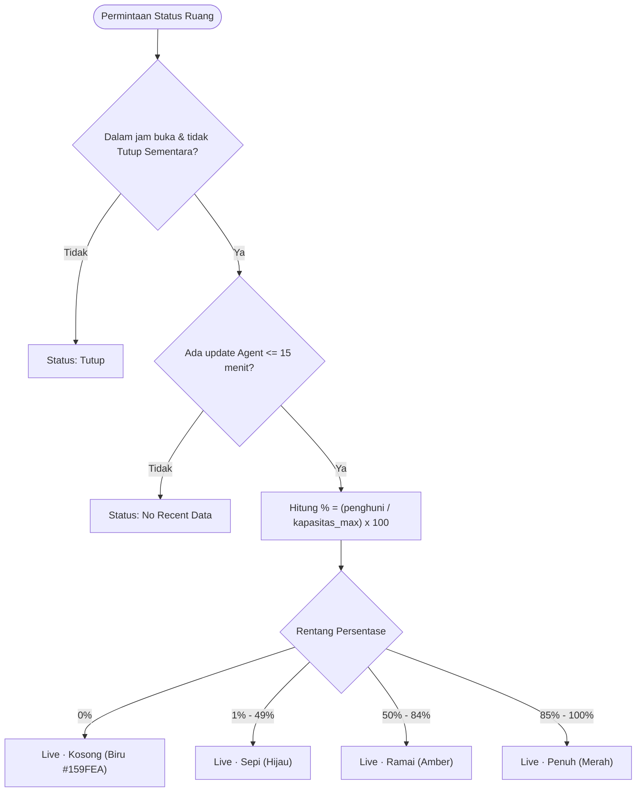
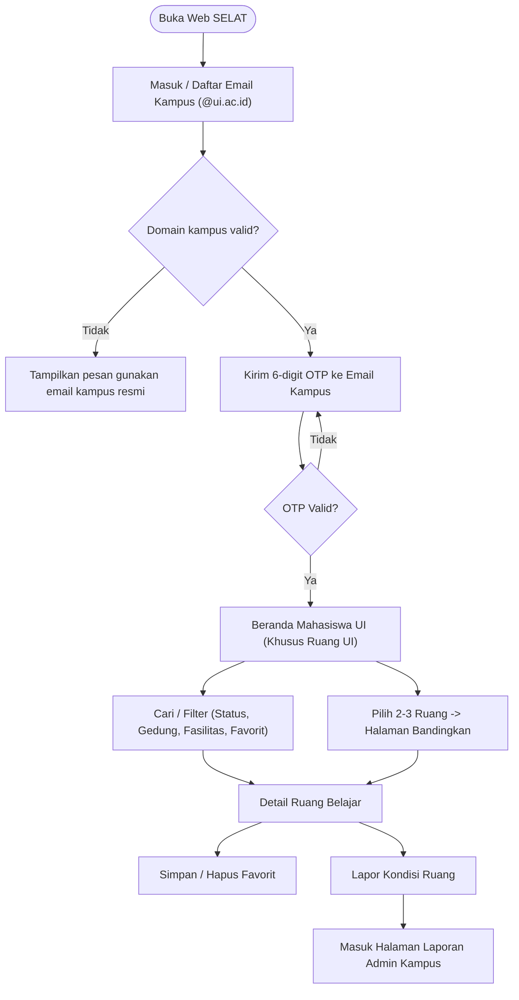
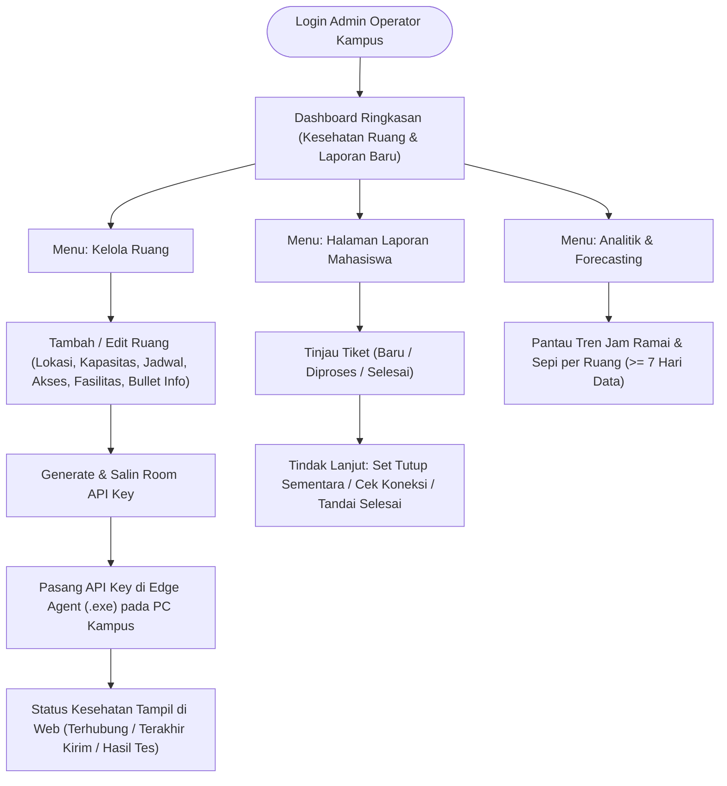
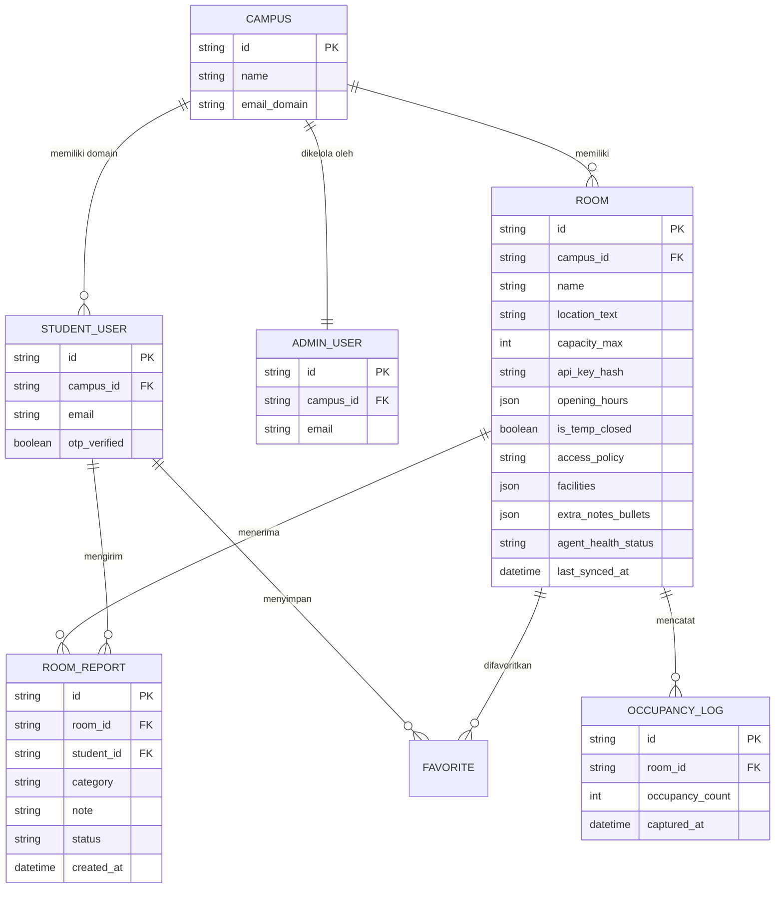

# SELAT: Dokumentasi Lengkap Arsitektur Data, User Flow & Screen Inventory

> **Pilot Kampus Awal:** Universitas Indonesia (`@ui.ac.id`)
> **Model Sumber Data:** 100% SELAT Edge Agent (`.exe` lokal bundel YOLO ONNX ringan)
> **Aktor:** Mahasiswa & Admin Operator Kampus (1 akun per kampus)
> **Dokumen Terkait:** [DESIGN.md](./DESIGN.md) | [figma-foundation-tokens.json](./figma-foundation-tokens.json)

---

## 1. Ringkasan Keputusan Arsitektur & Produk

| Aspek | Keputusan Final | Alasan |
|---|---|---|
| **Eksekusi YOLO** | Lokal di PC jaringan kampus via **SELAT Edge Agent (`.exe`)** | Privasi dan *consent* keamanan kampus terjaga karena nol video/foto keluar kampus; tidak butuh server GPU cloud mahal. |
| **Instalasi Edge Agent** | Paket `.exe` siap pakai (YOLO ONNX ringan sudah terbundel) | Petugas/IT kampus tidak perlu install Python, PyTorch, atau mengetik CMD; cukup CPU PC kantor standar (1 frame per 1-3 menit). |
| **Pairing Kamera ke Ruang** | **Campuran (Hybrid):** pairing lokal di Agent via **Room API Key** + pantauan kesehatan real-time di Dashboard Admin Web | Password CCTV RTSP tidak pernah menyentuh server SELAT, namun admin tetap bisa memantau status `Terhubung`, `Terakhir kirim`, dan `Hasil tes terakhir` dari web. |
| **Onboarding Mahasiswa** | Wajib email domain kampus (`@ui.ac.id`) + verifikasi **Kode OTP 6-digit** | Membuktikan kepemilikan akun mahasiswa aktif dan otomatis mengisolasi akses ruang khusus kampus terkait. |
| **Aksi Utama Mahasiswa** | Cari & filter ruang, Favorit, Bandingkan (2-3 ruang), Detail Ruang lengkap, **Lapor Kondisi Ruang** (tanpa link Google Maps) | Ruang sudah terfilter dalam satu kampus; laporan mahasiswa langsung masuk ke halaman khusus di Dashboard Admin untuk menutup *feedback loop* akurasi. |
| **Prioritas Status Ruang** | `Tutup` -> `No Recent Data` (>15 mnt tanpa update) -> `Live · Kosong (0%)` / `Sepi (1-49%)` / `Ramai (50-84%)` / `Penuh (85-100%)` | Di luar jam operasional status otomatis `Tutup` (bukan error/data basi). |
| **Aturan Forecasting** | Tampil jika data historis >= **7 hari**; sebelumnya tampil pesan jujur *"Data pola keramaian sedang dikumpulkan"* | Menjaga kejujuran data (tidak menampilkan grafik prediksi palsu pada ruang baru). |
| **Penanganan Laporan Admin** | **Halaman Laporan Mahasiswa** khusus di Dashboard Admin (`Baru`, `Diproses`, `Selesai`) | Admin dapat menindaklanjuti keluhan (cek koneksi Edge Agent, set *Tutup Sementara*, update jadwal, atau tandai selesai). |

---

## 2. Diagram Arsitektur End-to-End (CCTV -> Edge Agent -> SELAT -> Web App)



---

## 3. Sequence Diagram: Siklus Data Real-Time & Tindak Lanjut Laporan



---

## 4. Kontrak API & Spesifikasi Edge Agent (`.exe`)

### Endpoint Pengiriman Okupansi
- **Method & Path:** `POST /api/v1/occupancy`
- **Header:** `X-Room-API-Key: slt_live_9f2a_xxxx_81c4`
- **Request Body:**
```json
{
  "occupancy_count": 14,
  "captured_at": "2026-11-25T14:20:00+07:00",
  "agent_version": "1.0.0",
  "camera_health": "ok"
}
```
- **Response (`200 OK`):**
```json
{
  "room_id": "rm_ui_fib_lt2",
  "capacity_max": 40,
  "occupancy_pct": 35,
  "computed_status": "Sepi",
  "received_at": "2026-11-25T14:20:01+07:00"
}
```

### Kemampuan Minimum SELAT Edge Agent (`.exe`)
1. **Self-Contained:** Dikemas menjadi installer `.exe` (misal PyInstaller / Tauri + ONNX Runtime + model `yolo26n.onnx`), tanpa perlu install Python atau CMD.
2. **Auto-Discovery:** Memindai kamera ONVIF di jaringan lokal atau menerima input URL RTSP manual.
3. **Tes Koneksi 1-Klik:** Menguji snapshot 1 kali, menampilkan hasil hitungan contoh (misal *"Tes berhasil: 12 orang terdeteksi"*), lalu mengirim ping tes ke server agar status kesehatan di Dashboard Admin langsung hijau (`Terhubung`).
4. **Background Tray Service:** Berjalan ringan di *system tray* Windows dan otomatis mengambil 1 frame setiap 1 sampai 3 menit.

---

## 5. Logika Prioritas Status Ruang & Forecasting



---

## 6. User Flow Aktor 1: Mahasiswa (Pilot `@ui.ac.id`)



### Struktur Konten Halaman Detail Ruang Mahasiswa
- **Header:** Nama ruang, lokasi teks lengkap (`Lt. 2 Fakultas Ilmu Budaya, Universitas Indonesia`), badge status, tombol **Favorit**, tombol **Bandingkan**.
- **Kartu Okupansi Live:** Persentase besar, rasio kursi (`10 / 40 kursi`), `Occupancy Meter` 4-segmen, waktu pembaruan terakhir.
- **Forecasting Jam Sepi/Ramai:** Grafik pola per jam / per hari (atau state *"Data pola keramaian sedang dikumpulkan"* jika data < 7 hari).
- **Jadwal Buka & Tutup:** Jam operasional Senin sampai Minggu + sorotan hari ini.
- **Akses & Kebijakan:** Indikator apakah ruang publik untuk mahasiswa kampus dan apakah boleh mengajak teman/mahasiswa luar.
- **Fasilitas Ruang:** Tag fasilitas (Wi-Fi, Stopkontak, AC, Papan Tulis, Area Diskusi, Area Tenang).
- **Informasi Tambahan:** Daftar *bullet points* dari admin kampus.
- **Aksi Pelaporan:** Tombol **Lapor Kondisi Ruang** (tanpa link Google Maps).

---

## 7. User Flow Aktor 2: Admin Operator Kampus



---

## 8. Skema Entitas Data Ringkas (ERD)



---

## 9. Inventaris Layar untuk Prototype Figma (Page `Prototype`)

### A. Portal Mahasiswa (Desktop `1440px` & Mobile `390px`)
1. **`M-01` Masuk / Daftar & Verifikasi OTP (`@ui.ac.id`)**
2. **`M-02` Beranda Mahasiswa UI:** `Search Pill`, filter status/gedung/fasilitas/favorit, grid `Room Card`, dan bar mengambang **Bandingkan (2-3 ruang)**.
3. **`M-03` Detail Ruang Belajar:** 2-kolom desktop / 1-kolom mobile (Okupansi Live, Forecasting, Jadwal, Lokasi, Akses, Fasilitas, Bullet Info, Favorit, Bandingkan, dan tombol **Lapor Kondisi Ruang**).
4. **`M-04` Bandingkan Ruang (Side-by-Side):** perbandingan 2 sampai 3 ruang.
5. **`M-05` Modal Lapor Kondisi Ruang:** pilih kategori masalah + catatan + konfirmasi terkirim.

### B. Dashboard Admin Operator Kampus (Desktop `1440px`)
6. **`A-01` Ringkasan & Kesehatan Koneksi Ruang:** status semua ruang (`Terhubung`, `No Recent Data`, `Tutup`), jumlah laporan baru, daftar `API Key Row`.
7. **`A-02` Tambah / Edit Ruang & Manajemen API Key:** seluruh atribut ruang + tombol salin/reset API Key + status tes Edge Agent terakhir.
8. **`A-03` Halaman Laporan Mahasiswa:** daftar tiket laporan (`Baru`, `Diproses`, `Selesai`) + panel tindak lanjut cepat.
9. **`A-04` Analitik & Forecasting Ruang:** tren jam ramai/sepi historis per ruang.

### C. Mockup Pendukung (Presentasi Juri)
10. **`E-01` Jendela SELAT Edge Agent (`.exe`):** tampilan mini pairing API Key + pilih kamera ONVIF/RTSP + status hitungan YOLO lokal.
